# Serviloop

A field-service management app for small service businesses (plumbing, electrical, heating, cleaning). One owner keeps customers and technicians, creates and assigns jobs, moves them through their life, records what was done, and turns the notes into a customer-friendly summary they can edit and share. One codebase for iOS and Android.

> **Portfolio project, not a product.** It has no customers, no revenue and no store release. It exists to show end-to-end engineering: a typed mobile client, a Postgres backend with tested tenant isolation, and a carefully bounded AI feature. The status table below says exactly what is real, what is mocked and what is not done.

## The problem and who it is for

Owner-operators of 1–10 person service businesses often run their day from paper, WhatsApp and spreadsheets: who is going where, which jobs are open, what was done last time, and a professional write-up for the customer afterwards. Serviloop is the small, focused tool for that loop. It is deliberately **one owner login**: no technician or customer accounts, no payments or invoices (see [Limitations](#limitations)).

## What it does

| Area | What you can do |
|---|---|
| Account | Sign up and sign in with email and password; the session survives restarts (stored encrypted); sign out |
| Onboarding | Create your business, or start with a fictional **demo business** (6 customers, 3 technicians, 6 jobs) in one tap |
| Customers | List, add, edit, delete (a customer with jobs cannot be deleted) |
| Technicians | List, add, edit, deactivate and reactivate (never deleted, so job history stays) |
| Jobs | Create and edit with customer, optional technician, optional date and time (native pickers), description; delete |
| Job detail | Move a job through Open → In progress → Completed (or Cancelled / reopen) with one tap; write completion notes |
| Dashboard | Live counts of Open / In progress / Completed (plus Cancelled and total) and the five most recently changed jobs |
| Customer summary | **Generate** a draft from the saved notes, **edit** it, **save** it, **share** it with the phone's share sheet |

## Status: what is real, what is mocked

| Piece | Status |
|---|---|
| Auth, onboarding, customers, technicians, jobs, status and notes, dashboard | **Implemented**, against a real hosted Supabase project (Postgres + RLS) |
| Tenant isolation (one business can never read or change another's data) | **Implemented and tested**: 71 scripted checks against the hosted project |
| AI summary: function, limits, editing, saving, sharing | **Implemented and tested**, including the per-user rate limit |
| AI summary: the text itself | **Demo mode (mock).** Without an AI key the function returns a clearly labelled template that only restates your notes, and the app shows a "Demo summary" badge. The live Claude Haiku 5.5 call is **written but has never been run against the provider** (no key was configured yet), so it is not claimed as working |
| iOS and Android | One codebase for both, running in Expo Go. **Verified on the Android emulator and the iOS simulator** (the developer tested the flows on both). The recorded checklist and screenshots are Android-only; see [`docs/TEST_PLAN.md`](docs/TEST_PLAN.md) |
| Store release, accounts for technicians or customers, payments, offline mode | **Not built** (see Limitations) |

## Architecture

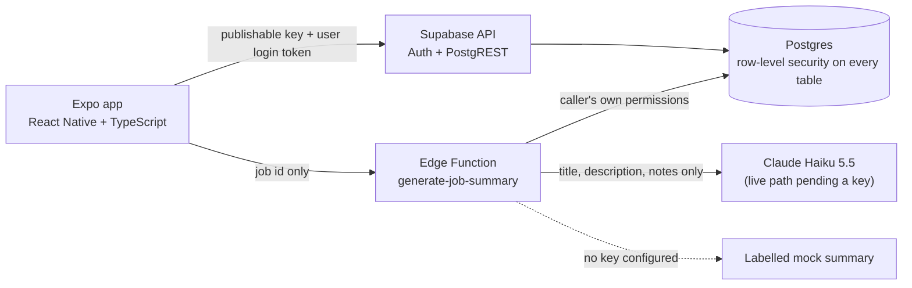

In the app, data flows one way: **screen → feature hook → repository → Supabase client → Postgres**. Screens only render; hooks hold loading, error and form state; repositories are the only code that talks to Supabase; the database enforces access. Details, the data model and the security reasoning are in [`docs/ARCHITECTURE.md`](docs/ARCHITECTURE.md).

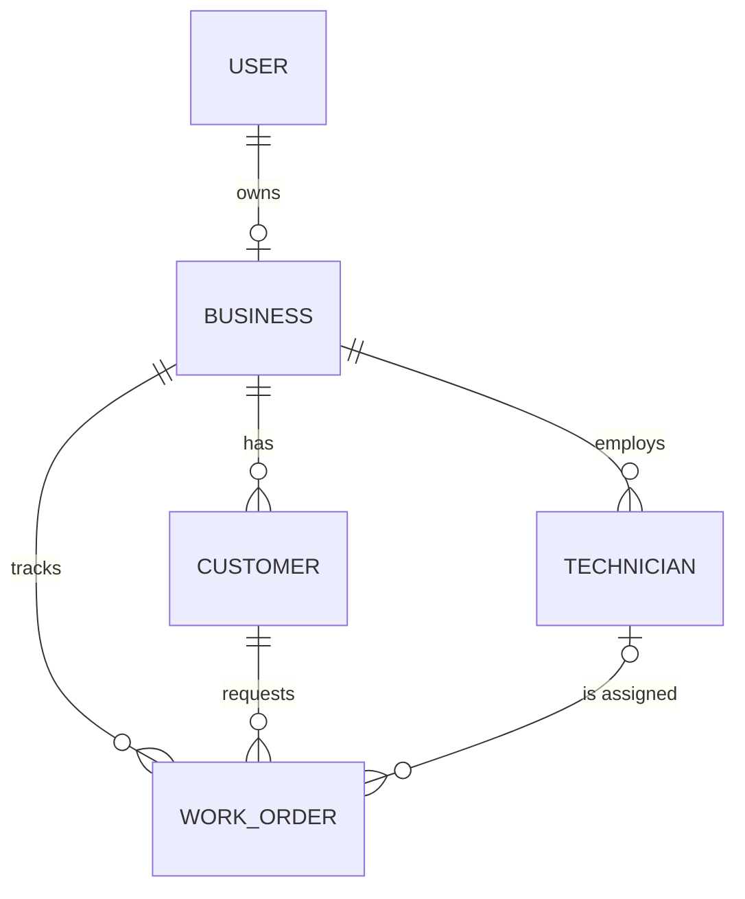

A job can only point at a customer or technician **of the same business**: this is enforced by composite foreign keys in the database, not by the app.

## Stack

| Concern | Choice |
|---|---|
| App | React Native 0.86 · React 19 · Expo SDK 57 (Expo Go; no custom native code) · TypeScript (strict) |
| Navigation | Expo Router (file-based) |
| Backend | Supabase: Auth, Postgres with row-level security, one Edge Function (Deno) |
| Data access | `@supabase/supabase-js` 2.x through a repository layer |
| Validation | Zod (every form, and every reply from the network) |
| Styling | Core `StyleSheet` and a small theme (light and dark) |
| AI | Claude Haiku 5.5 through the official SDK, inside the Edge Function only |
| Tests | Jest and React Native Testing Library; scripted security checks against the hosted project |
| Tooling | npm (one lockfile), ESLint, `tsc`, GitHub Actions |

Deliberately absent: Redux or other state libraries, ORMs, UI kits, analytics. See [`docs/DECISIONS.md`](docs/DECISIONS.md) for the reasoning behind every non-obvious choice (D-001 onwards).

## Security model

- The app holds **only the project URL and the publishable key**. Both are public by design; access control lives in the database.
- **Row-level security on every table**, with every default privilege revoked and then granted narrowly. A row is visible and changeable only if its business belongs to the signed-in user. Column grants make ids, owners and business links unwritable after creation, so rows cannot be moved to another business.
- **Tenant integrity in the schema:** composite foreign keys stop a job from referencing another business's customer or technician, even with a forged id.
- **The AI function** verifies the caller, reads the job with the caller's own permissions (a job that is not yours looks exactly like one that does not exist), refuses empty or oversized input before spending anything, limits each user to 10 summaries per hour and 30 per day (atomically, in the database), makes one call with a 20-second timeout and no retries, treats notes as data rather than instructions, and returns only fixed friendly errors. Only the job's title, description and notes are sent to the model; never customer names, phone numbers or addresses. The AI key exists only as a Supabase function secret.
- **How it was tested:** `npm run test:rls` signs up throwaway users on the hosted project and attacks across accounts (reads, edits, deletes, forged foreign keys, signed-out access, the rate-limit table): **71 of 71 checks pass**. `npm run test:summary` exercises the deployed function (authentication, input, ownership, limits): **22 of 22 pass**. Results and the limits of this evidence are in [`docs/TEST_PLAN.md`](docs/TEST_PLAN.md).

## Run it yourself

You need your own Supabase project (the free tier is enough). Nothing here needs a paid service.

**Prerequisites:** Node.js (developed on 24), npm, the iOS simulator (Xcode) and/or an Android emulator, the [Expo Go](https://expo.dev/go) app on that simulator or emulator, a free [Supabase](https://supabase.com) account.

1. **Install**
   ```bash
   git clone https://github.com/NosherKhalid/serviloop.git
   cd serviloop
   npm ci
   npm run check        # lint + typecheck + tests; needs no backend and no .env
   ```
2. **Create the backend** in your Supabase project:
   - Authentication → Sign In / Providers → Email: turn **Confirm email off** (so sign-up returns a session in the demo).
   - Link and apply the schema (this also loads the demo-data function and the AI rate limit):
     ```bash
     npx supabase login
     npx supabase link --project-ref <your-project-ref>
     npx supabase db push
     ```
3. **Configure the app:** copy `.env.example` to `.env` and fill in the two public values from Project Settings → API (the project URL and the **publishable** key). Never put a secret or service-role key here.
4. **Run:** `npm start`, then press `i` (iOS simulator) or `a` (Android emulator) and open the app in Expo Go. Sign up and tap **Start with demo data**.
5. **Optional, the AI summary function:**
   ```bash
   npx supabase functions deploy generate-job-summary
   ```
   Without an AI key it answers in labelled demo mode. To enable the live model, create an Anthropic API account, set a monthly spend limit there, then `npx supabase secrets set ANTHROPIC_API_KEY=<your key>` and redeploy. The steps and the known risks are in D-041 of the decisions log.
6. **Verify your backend:** `npm run test:rls` and `npm run test:summary` (both create throwaway users in your project).

Troubleshooting notes for the iOS simulator on Xcode 27 and for Android Expo Go are in [`docs/DECISIONS.md`](docs/DECISIONS.md) (D-008, D-011, D-012).

## Screenshots

All screenshots are from the **Android emulator** with a fictional demo account (dark mode, demo mode for the AI summary). The iOS simulator was tested but not captured (see Status and [`docs/TEST_PLAN.md`](docs/TEST_PLAN.md)).

<table>
  <tr>
    <td align="center">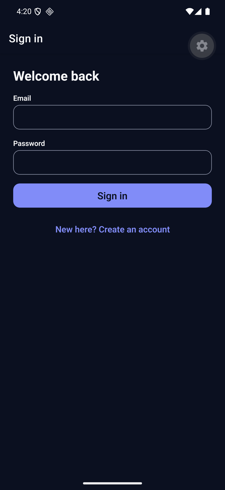<br><sub>1. Sign in</sub></td>
    <td align="center">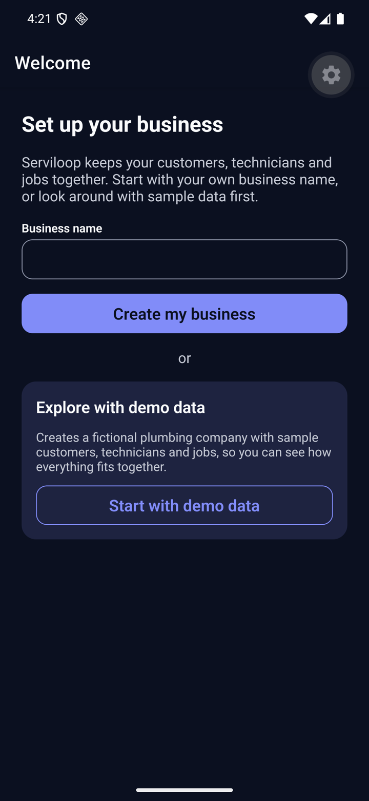<br><sub>2. First run: create a business or start with demo data</sub></td>
    <td align="center">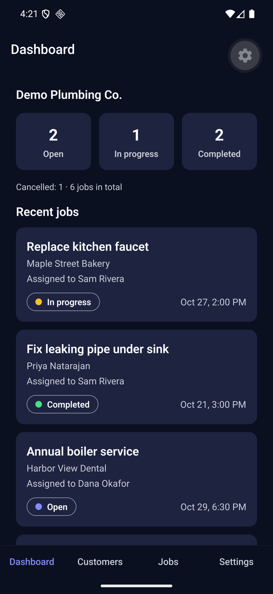<br><sub>3. Dashboard: live counts and recent jobs</sub></td>
  </tr>
  <tr>
    <td align="center">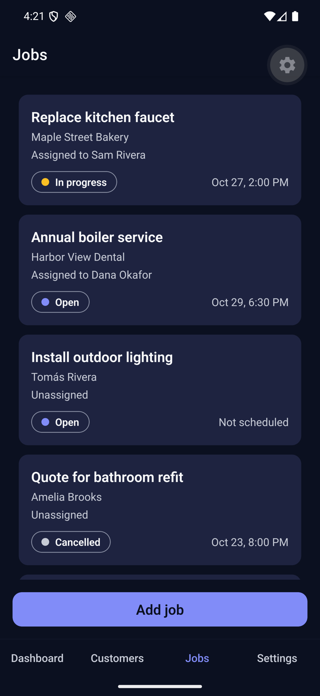<br><sub>4. Jobs, unfinished first</sub></td>
    <td align="center">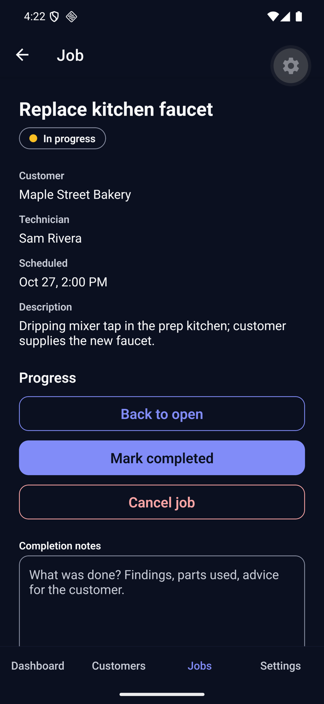<br><sub>5. Job detail: only the allowed next moves</sub></td>
    <td align="center">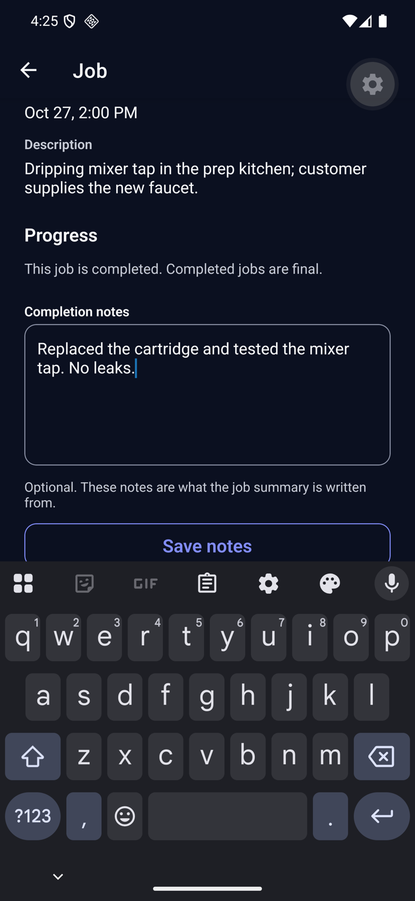<br><sub>6. Completion notes stay above the keyboard</sub></td>
  </tr>
  <tr>
    <td align="center">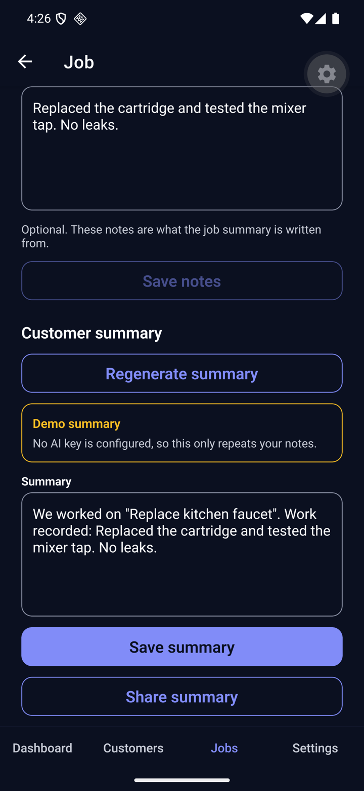<br><sub>7. Customer summary: editable draft, labelled "Demo summary" in demo mode</sub></td>
    <td align="center">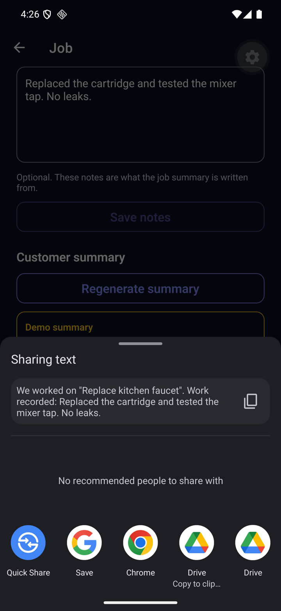<br><sub>8. Share the summary with the phone's share sheet</sub></td>
    <td align="center">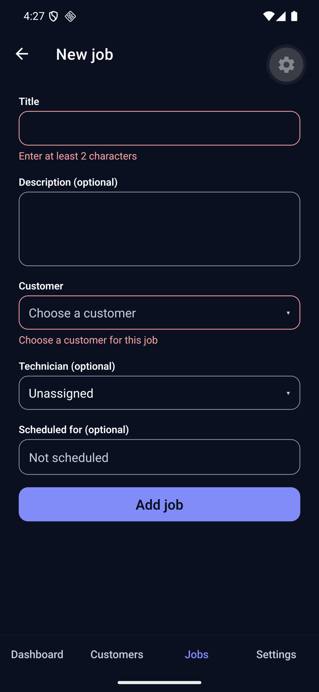<br><sub>9. New job: validation messages</sub></td>
  </tr>
  <tr>
    <td align="center">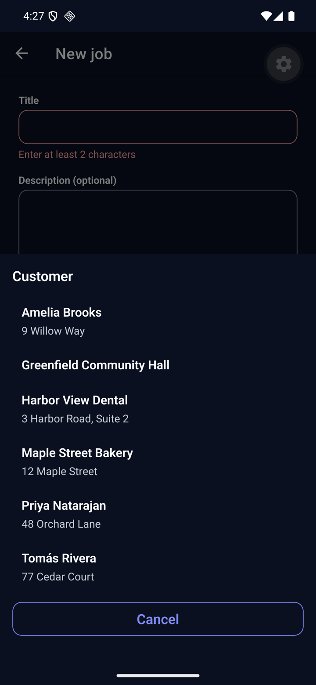<br><sub>10. Pick a customer</sub></td>
    <td align="center">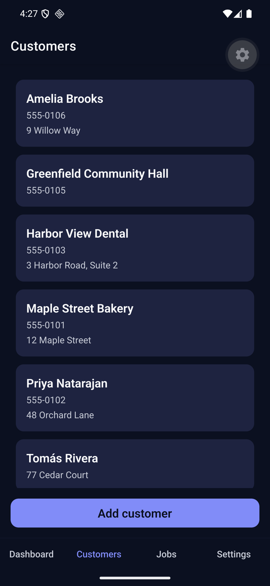<br><sub>11. Customers</sub></td>
    <td align="center">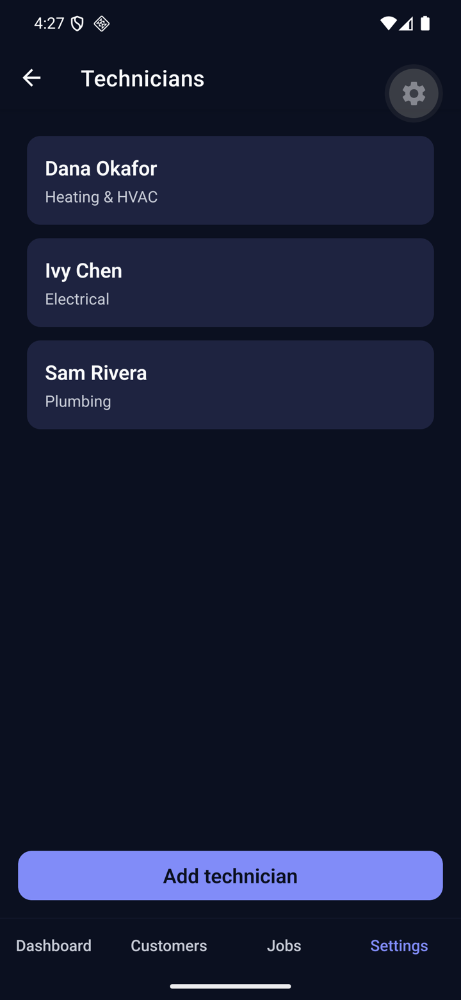<br><sub>12. Technicians</sub></td>
  </tr>
</table>

## Demo (about two minutes)

1. Sign up, then **Start with demo data**: a fictional plumbing business appears.
2. **Dashboard:** open, in-progress and completed counts and the latest jobs.
3. **Jobs → Add job:** pick a customer, optionally a technician, date and time.
4. Open the job: **Start job**, type completion notes, **Mark completed**. The Dashboard counts change when you go back.
5. **Generate summary:** a draft appears (labelled "Demo summary" in demo mode). Edit it, **Save**, **Share**.
6. Sign out and back in: everything is still there.

## Limitations

- **One owner login per business.** No technician or customer accounts, no roles.
- **No payments, invoices, calendar view, push notifications, photo attachments, search or offline mode.**
- **AI summary is in demo mode** until an AI key is configured; the live path is unverified (see Status).
- **Job status rules are enforced by the app, not the database** (tenant isolation is database-enforced and unaffected).
- A business cannot be renamed or deleted in the app, and there is no account deletion (required before any store release).
- Email confirmation is off for the demo; there is no password reset flow.
- Built for English only; right-to-left languages are not supported.
- The hosted-database test scripts are manual: GitHub Actions runs lint, typecheck and unit tests only.
- **Verification record:** the recorded checklist, screenshots and results are Android-only (iOS was tested by the developer on the simulator without a recorded checklist). Light mode and large text sizes were checked on Android in part; offline behaviour on the new screens and screen readers (VoiceOver, TalkBack) were not checked on a device.

The roadmap (and why each item is outside the first version) is in [`BACKLOG.md`](BACKLOG.md).

## Project layout

```
src/app/            Expo Router routes (thin: they only render a screen)
src/features/       auth, customers, technicians, workOrders, dashboard, onboarding, settings
src/repositories/   the only code that talks to Supabase
src/components/     shared UI (Button, Input, pickers, ...)
src/theme/          colours, spacing, typography (light and dark)
supabase/           migrations, the Edge Function, scripted security checks
docs/               architecture, decisions, test plan, progress, learning log
__tests__/          Jest tests
```

## How this was built, and AI-assistance disclosure

Serviloop was built by Nosher Khalid, a senior iOS engineer new to React Native and TypeScript, working with **Claude Code** (Anthropic's AI coding assistant) as a pair programmer. Claude Code wrote most of the code and tests under the developer's direction and review, in small milestones (M0–M6), each ending in a review. Every non-obvious decision is written down in [`docs/DECISIONS.md`](docs/DECISIONS.md), what was learned along the way is in [`docs/LEARNING_LOG.md`](docs/LEARNING_LOG.md), and the honest record of what was verified (and what was not) is in [`docs/TEST_PLAN.md`](docs/TEST_PLAN.md). The summary feature also uses an AI model at runtime when it is enabled; in demo mode it does not.

## Documentation

[`docs/PROJECT_SPEC.md`](docs/PROJECT_SPEC.md) (the brief) · [`docs/ARCHITECTURE.md`](docs/ARCHITECTURE.md) · [`docs/DECISIONS.md`](docs/DECISIONS.md) · [`docs/TEST_PLAN.md`](docs/TEST_PLAN.md) · [`docs/PROGRESS.md`](docs/PROGRESS.md) · [`docs/LEARNING_LOG.md`](docs/LEARNING_LOG.md) · [`docs/PORTFOLIO.md`](docs/PORTFOLIO.md) · [`BACKLOG.md`](BACKLOG.md)

## Licence

Copyright © 2026 Nosher Khalid. All rights reserved. The source is published for portfolio review; no licence to copy, modify or redistribute it is granted.
