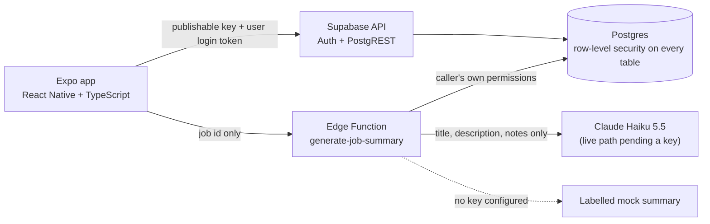

# Architecture

Status: data model and security are built (M1); accounts, session handling and business onboarding are built (M2). Customers, technicians and jobs are read, created, edited and (jobs and customers) deleted against the real database (M3); the Dashboard and the Job detail screen (status moves and completion notes) are built (M4).

## Data flow
```
Screen -> feature hook -> repository -> Supabase client -> Postgres (RLS) -> response -> screen
                                                      \-> Edge Function (M5) -> AI provider
```
The same picture as a diagram (renders on GitHub; the text above carries the same facts):

- The app holds only the **publishable key**. Every request carries the signed-in user's login token, and the database decides what that user may see or change.
- Secret keys and the AI provider key never enter the app (AI key lives only as an Edge Function secret).

## Data model (hosted Supabase Postgres)
```
auth.users (Supabase Auth)
   1
   |  owner_id (unique: one business per owner in v0.1)
   v
businesses -----< customers      (business_id)
     |------< technicians        (business_id)
     \------< work_orders        (business_id, customer_id, technician_id?)
                 FK (customer_id,   business_id) -> customers   (id, business_id)
                 FK (technician_id, business_id) -> technicians (id, business_id)
```
- Composite foreign keys mean a job can only reference a customer or technician of the **same business**, even with a forged id.
- `work_orders.status` is one of `open`, `in_progress`, `completed`, `cancelled`.
- Customers/technicians that still have jobs cannot be deleted; technicians are deactivated (`active`).
- Migrations: `supabase/migrations/20261024103554_core_schema.sql` (tables, rules, RLS) and `20261024105337_demo_data.sql` (`load_demo_data()`).
- TypeScript types are generated from the live schema into `src/types/database.ts` (`npm run db:types`).

## Security model (row-level security)
- RLS is on for all four tables, and every default privilege is revoked, then re-granted narrowly to signed-in users.
- A row is visible and changeable only if its `business_id` belongs to a business whose `owner_id` is the signed-in user.
- Column-level grants make `id`, `owner_id`, `business_id`, `created_at` and `updated_at` unwritable after creation, so rows cannot be moved or re-owned.
- Signed-out visitors have no access to any table or to `load_demo_data()`.
- The AI rate-limit table `ai_summary_usage` has RLS on and no privileges for the app at all; only `claim_ai_summary_slot()` (SECURITY DEFINER, user = `auth.uid()`) can add to it (D-039).
- Evidence: see `docs/TEST_PLAN.md` (71 scripted checks against the hosted project, plus 22 against the deployed AI function).

## Demo data
`public.load_demo_data()` runs with the caller's permissions (security invoker), creates their business if missing, and inserts fictional data only into an empty business. See D-021.

## Accounts, session and onboarding (M2)
```
app start -> splash held -> restore saved session (encrypted storage) -> signed in?
   no  -> (auth) sign in / create account
   yes -> look up the owner's business (RLS returns only their own)
            none       -> (onboarding): create my business  |  start with demo data -> "Loaded 6 customers..." -> Continue
            ready      -> (app) tabs
            lookup fails (offline) -> "Can't load your business" + Try again
```
- **One Supabase client** (`src/lib/supabase.ts`) with the publishable key; the login session is stored encrypted (AES key in Keychain/Keystore, ciphertext in AsyncStorage), see D-025.
- **Providers hold cross-screen state only:** `AuthProvider` exposes `{ status, user: { id, email } }` (never tokens); `BusinessProvider` remembers the business together with *who* it belongs to, so switching accounts can never show the previous owner's business.
- **Route guards** (`Stack.Protected`) in `src/app/_layout.tsx` pick `(auth)`, `(onboarding)` or `(app)` from that state; nothing navigates by hand.
- **Friendly errors:** fixed messages for wrong credentials, existing email, rate limits, offline and expired sessions; raw service text is never shown.

## Customers, technicians and jobs (M3)
```
Screen (list / form) -> feature hook (useCustomers, useWorkOrderForm, ...) -> repository -> Supabase -> RLS
```
- **Repositories** (`customerRepository`, `technicianRepository`, `workOrderRepository`) are the only code that queries tables. They convert database rows (snake_case) to app types (camelCase) and throw the service error; hooks and `dataErrorMessage` turn that into one friendly sentence. A job list is one request that also returns the customer and technician names through the composite foreign keys.
- **Validation** is a pure Zod function per form (`validation.ts`), run before any request; the database rules are the second line.
- **Navigation:** each tab owns a stack (list -> new / edit). Saving or deleting calls `router.dismissTo(list)` so the result does not depend on how the screen was opened (D-034). Screens that offer choices (the job form) refetch customers and technicians whenever they regain focus, because tabs stay mounted.
- **Shared pieces:** `OptionPicker` (list sheet for customer and technician), `DateTimeField` (native date and time controls), `DeleteButton` (confirmation alert, permanent delete, friendly errors).
- **Delete rules:** jobs and customers can be deleted by their owner; a customer with jobs is refused by the database (foreign key). Technicians are deactivated, never deleted (D-035).
- **Times** are stored as UTC and shown in the phone's time zone (D-032, D-033).

## Dashboard and job detail (M4)
```
Dashboard tab -> useDashboard -> countWorkOrdersByStatus (4 head counts) + listRecentWorkOrders(5) -> RLS
Job detail    -> useWorkOrderDetail (refetch on focus) + useWorkOrderProgress -> updateWorkOrderProgress({ status?, completionNotes })
```
- **Counts** are four small `count` requests (`head: true`, one per status) sent together, so the numbers always come from the database; if any fails the whole screen shows a retryable error, never a half-right number (D-037). "Recent" = the 5 jobs with the newest `updated_at`.
- **Both screens refetch whenever they regain focus**, silently after the first load (no spinner; a failed refresh keeps what is on screen), because tabs and stacks stay mounted (D-034).
- **Job detail** is separate from the edit form (D-036): the allowed next moves (`status.ts`, D-017) are buttons, "Mark completed" or any move saves the typed notes in the same update, and `updateWorkOrderProgress` writes only `status` and `completion_notes` (D-038). Routes: `work-orders/[id]/index` (detail) and `[id]/edit`.
- **Known limit:** `anchor: 'index'` does not apply to jumps between tabs, so a screen opened that way has no back arrow (see `BACKLOG.md`).

## AI job summary (M5)
```
Job detail -> useJobSummary -> summaryRepository -> supabase.functions.invoke('generate-job-summary', { workOrderId })
   Edge Function: login check -> body check -> read the job AS THE CALLER (RLS) -> notes check -> claim_ai_summary_slot() -> model | labelled mock
   reply { summary, source: 'ai' | 'mock' } -> editable draft in the app -> Save -> work_orders.ai_summary (normal RLS update)
```
- **The app sends only the job id.** The function loads the notes itself, so arbitrary text can never be sent to the model, and the provider key exists only as a function secret (D-039).
- **Order of checks is the security design:** identity (platform JWT check plus `createSupabaseContext`), exact input shape, ownership through row-level security (a foreign job gets the same 404 as a missing one), empty or oversized notes refused before any spend, then the per-user limit, then the model call (one attempt, 20 s, no retries). Only the title, description and notes reach the model.
- **Rate limit:** `ai_summary_usage` is a locked table (no privileges for the app); `claim_ai_summary_slot()` (SECURITY DEFINER, user = `auth.uid()`, per-user advisory lock) allows 10 per hour and 30 per day and fails closed.
- **Mock mode:** with no `ANTHROPIC_API_KEY` the function returns a template that only restates the notes, labelled `source: 'mock'`; the app shows a "Demo summary" badge. **Current state: mock mode.** The live branch is implemented but has not been run against the provider (D-041).
- **Pure logic** (`supabase/functions/generate-job-summary/logic.ts`) has no Deno APIs, so Jest tests it; `index.ts` is excluded from the app's `tsc` and ESLint.
- **App side:** `summaryRepository` validates the reply with Zod and maps refusal codes to fixed sentences (`SummaryError`); `useJobSummary` separates the saved text from the unsaved draft; Share uses React Native's built-in share sheet.

## Not built yet
Live AI in production (needs the provider key, D-041), README and screenshots (M6).
